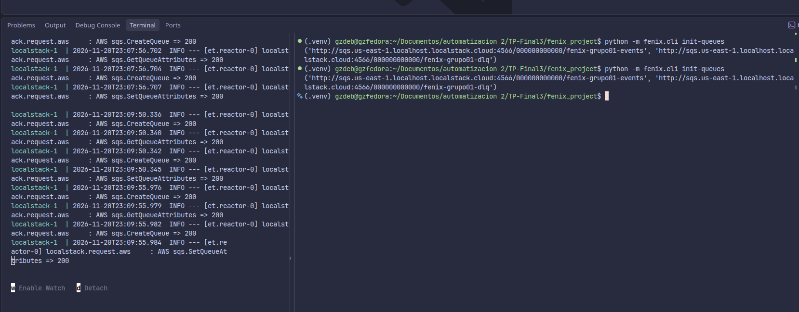
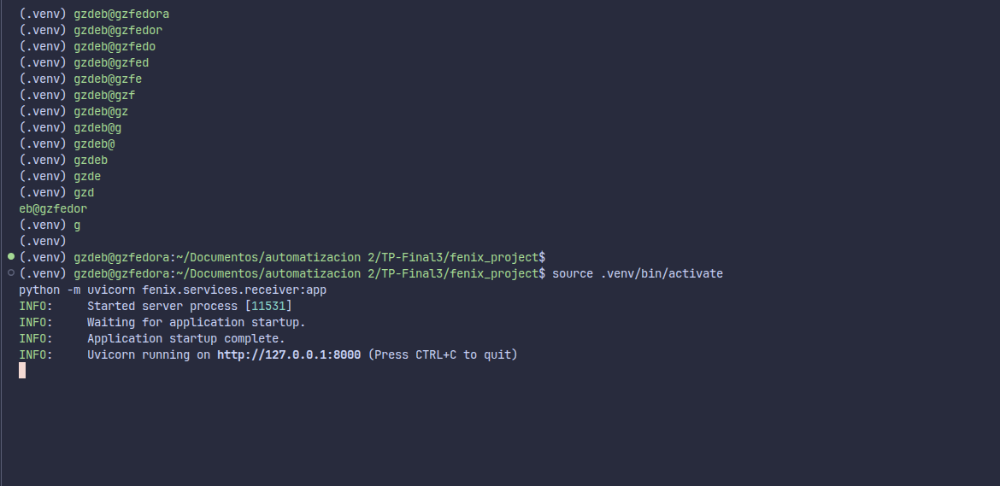
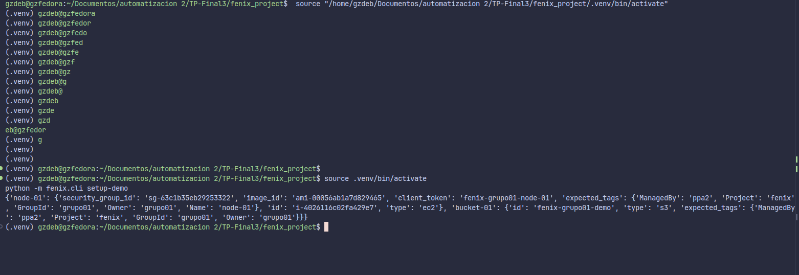
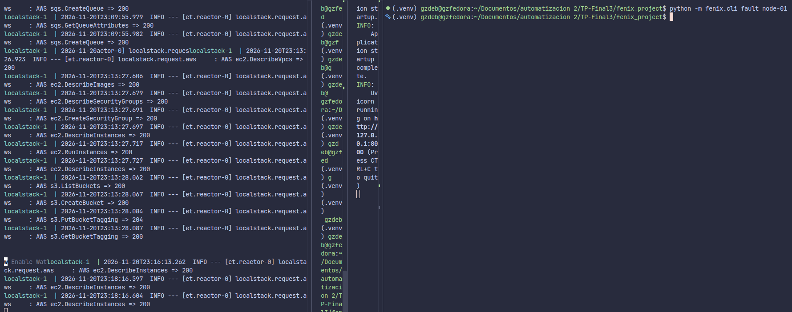
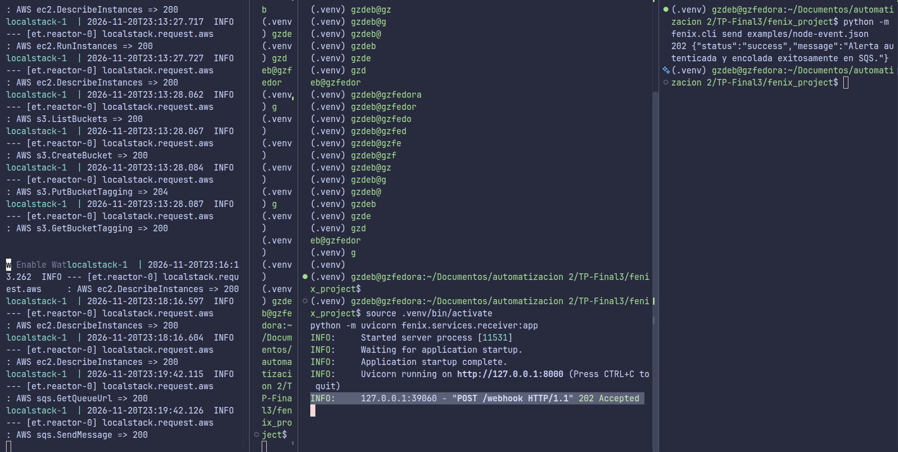
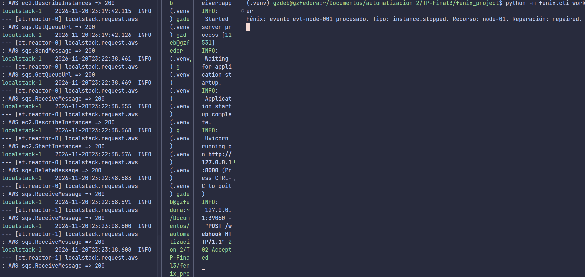
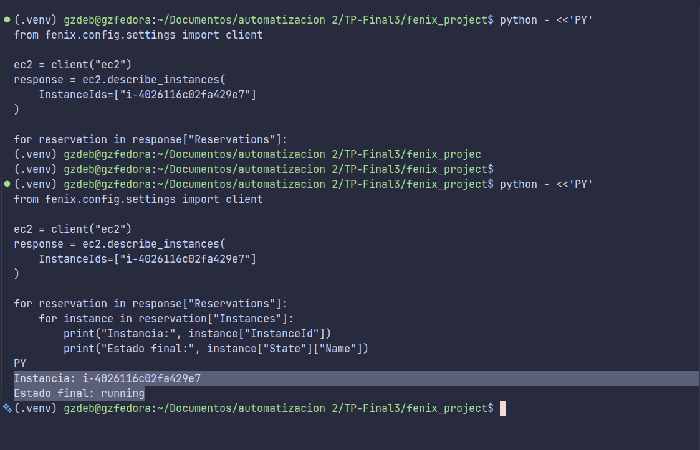
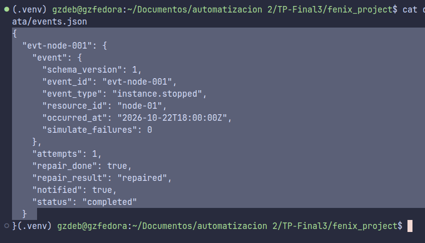
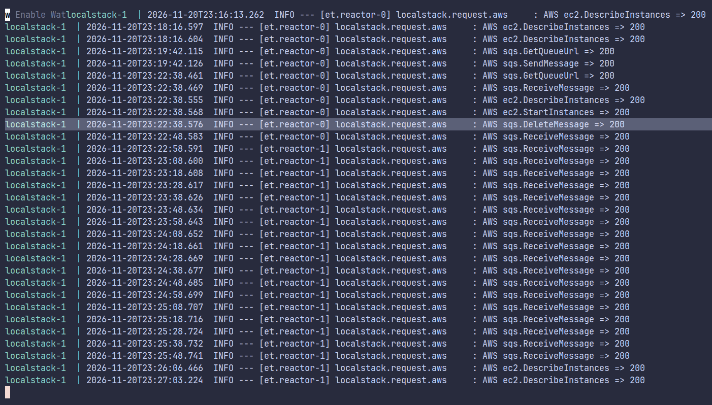

# Evidencias de Integración y Worker (I5)

## 1. Objetivo

El objetivo es demostrar el funcionamiento del flujo de procesamiento de eventos mediante AWS SQS en LocalStack, la ejecución del worker, la reparación del recurso afectado y la confirmación del mensaje una vez finalizado su procesamiento.

## 2. Escenario de prueba

Se ejecutó el escenario nominal de reparación de una instancia EC2 identificada como `node-01`.

El flujo realizado fue:

1. Inicialización de las colas SQS y DLQ.
2. Puesta en marcha del receptor HTTP.
3. Preparación de los recursos de demostración.
4. Inducción de un fallo en la instancia `node-01`.
5. Envío del evento mediante el webhook.
6. Recepción y procesamiento del mensaje por el worker.
7. Reparación de la instancia EC2.
8. Persistencia del resultado del procesamiento.
9. Confirmación y eliminación del mensaje de SQS (ACK).

## 3. Evidencias del flujo nominal

### 3.1. Inicialización de colas SQS

Se ejecutó el comando `init-queues` para crear las colas necesarias para el procesamiento de eventos y el manejo de mensajes fallidos.

### 3.2. Receptor HTTP activo

Se inició el servidor Uvicorn para exponer el endpoint `/webhook`, encargado de recibir los eventos y derivarlos a SQS.

### 3.3. Preparación de recursos

Se ejecutó `setup-demo` para preparar los recursos de laboratorio definidos en el inventario, incluyendo la instancia EC2 `node-01` y el bucket S3 de demostración.

### 3.4. Inducción del fallo

Se ejecutó `fault node-01` para detener la instancia EC2 y generar el escenario que debía ser detectado y reparado.

Los registros de LocalStack permiten verificar las operaciones realizadas sobre EC2.

### 3.5. Recepción del evento y envío a SQS

Se envió el evento mediante `send examples/node-event.json`.

El receptor respondió con HTTP `202 Accepted` y LocalStack registró `sqs.SendMessage => 200`, confirmando que el evento fue aceptado y enviado a la cola.

### 3.6. Procesamiento del worker

Se ejecutó el worker, que recibió el evento `evt-node-001`, identificó el tipo `instance.stopped` y completó el procesamiento indicando el resultado `repaired`.

### 3.7. Verificación del estado final de EC2

Se consultó el estado de la instancia mediante Boto3.

El resultado obtenido fue `running`, verificando que la reparación se aplicó efectivamente sobre el recurso.

### 3.8. Persistencia del resultado

Se verificó el registro del evento en `data/events.json`.

Los valores obtenidos fueron:

- `repair_done`: `true`
- `repair_result`: `repaired`
- `notified`: `true`
- `status`: `completed`

Esto permite comprobar que el resultado del procesamiento quedó persistido localmente.

### 3.9. Confirmación del mensaje (ACK)

Los registros de LocalStack muestran la secuencia de recepción, reparación y confirmación del mensaje:

- `sqs.ReceiveMessage => 200`
- `ec2.StartInstances => 200`
- `sqs.DeleteMessage => 200`

La operación `DeleteMessage` confirma que el mensaje fue eliminado de SQS después de completar el procesamiento.

## 4. Resultado

El escenario nominal de `node-01` finalizó correctamente.

Se verificó que:

- El webhook recibió el evento.
- SQS almacenó el mensaje.
- El worker procesó el evento.
- La instancia EC2 pasó al estado `running`.
- El resultado quedó registrado en el archivo de persistencia.
- SQS confirmó la eliminación del mensaje mediante ACK.

Estas evidencias permiten demostrar la integración entre el receptor HTTP, SQS, el worker y el servicio EC2 simulado mediante LocalStack.

## 5. Consideración sobre la notificación

El registro persistido indica `notified: true`. En esta ejecución no se obtuvo una salida visible independiente del contenido de la notificación en la consola. Por lo tanto, se documenta el estado registrado sin atribuirle una verificación adicional del mensaje emitido.

