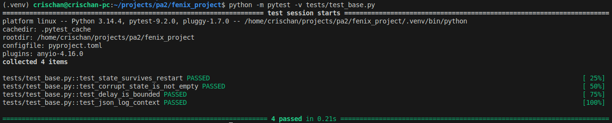
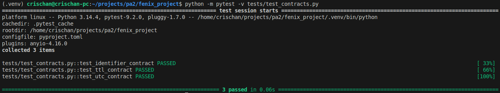
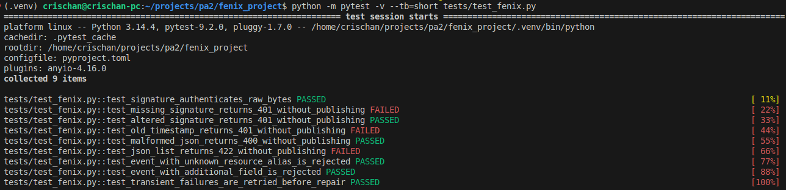
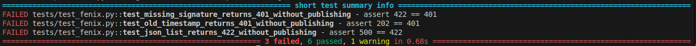
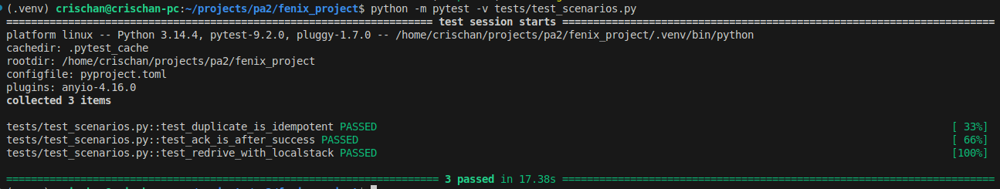
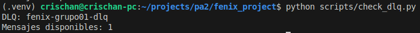
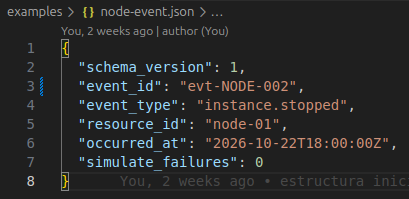
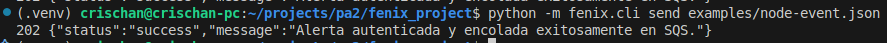
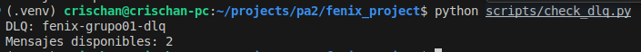
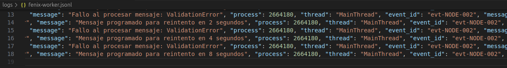

## Evidencias Reproducibles del integrante 6

## Apoyos entregados

- ### Test Base (Prueba el apoyo entregado)
    `python -m pytest -v tests/test_base.py`

- ### Test Contracts (Evalúa el cumplimiento de contratos en validation.py)
    `python -m pytest -v tests/test_contracts.py`

## Tests implementados por i6

- ### Test Fenix
    Tests cubiertos de la Matriz de Pruebas
    - F04	Firma ausente/alterada y timestamp de hace una hora	401 y ningún mensaje nuevo
    - F05	Mismos datos JSON con bytes distintos tras firmar	401 por HMAC inválida
    - F06	JSON roto firmado; luego lista JSON firmada	400 y 422 respectivamente; sin publicación
    - F07	Alias ajeno y claves extra	Rechazo de esquema; ningún cambio cloud
    - F09	simulate_failures=2, ID nuevo	Backoff 2 y 4; después reparación y ACK

    `python -m pytest -v --tb=short tests/test_fenix.py`

- ### Test Scenarios
    `python -m pytest -v --tb=short tests/test_scenarios.py`

## Prueba de ejecución: Una falla llega efectivamente a DLQ

En la siguiente prueba de integración:
- Enviaremos un evento que no cumpla el contrato.
- El webhook lo encolará al SQS
- El worker reintentará validarlo 3 veces y luego SQS lo envía a la DLQ

### Con el proyecto levantado y el worker en ejecución

### 1. Usamos un script auxiliar con boto3 para ver el tamaño de la DLQ
`python scripts/check_dlq.py`

### 2. Evento que incumple validación

### 3. Enviamos el evento
`python -m fenix.cli send examples/node-event.json`

### 4. Volvemos a chequear el tamaño de la DLQ
`python scripts/check_dlq.py`

Nota: Efectivamente el tamaño de la DQL se ve incrementado

### 5. Revisamos Logs del Worker (Analizamos comportamiento)

Podemos observar que el worker levantó los ValidationError en cada lectura y ejecutó el backoff, aunque no muestre la derivación del evento a la DLQ.
